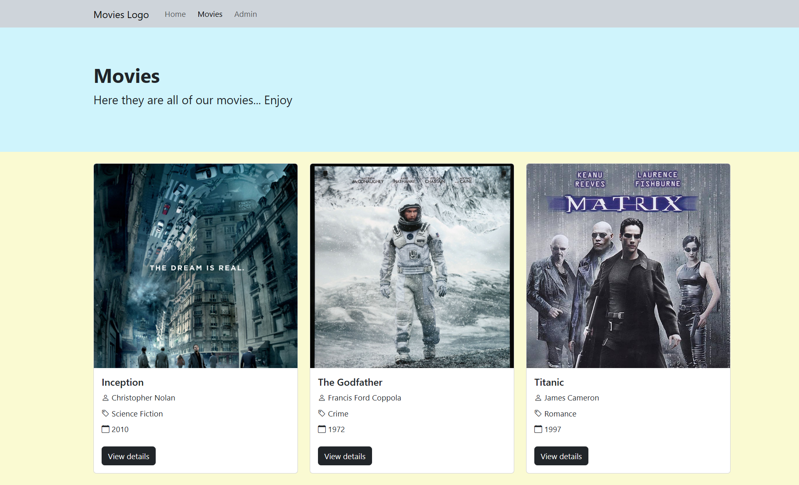

# 🚀 WebApp React - Movies Frontend

> Frontend React per consultare film, vedere dettagli/recensioni e aggiungere nuovi film tramite area admin, collegato a una API Express.




---

## 🌍 Demo

- Live: locale su `http://localhost:5173`
- Video/GIF: screenshot in `readme-img/moviePage-preview.png`

---

## 🌟 Caratteristiche principali

- **Catalogo film**: visualizzazione lista film da API con card e accesso al dettaglio.
- **Dettaglio film + recensioni**: pagina dedicata al film con elenco recensioni e form per aggiungerne di nuove.
- **Area admin**: sezione con form multipart per creare un film (incluso upload poster) e anteprima del risultato.
- **Navigazione client-side**: routing con layout pubblico/admin e fallback `404 Not Found`.
- **Stato globale loader**: gestione caricamento centralizzata tramite Context API.

---

## 🛠️ Tech Stack

| Tecnologia               | Scopo                      |
| :----------------------- | :------------------------- |
| **React 19 + Vite**      | Core frontend SPA          |
| **React Router DOM**     | Routing pagine/layout      |
| **Axios**                | Chiamate HTTP alla API     |
| **Bootstrap 5 + Icons**  | UI e componenti grafici    |
| **Express API (extern)** | Fonte dati (`/api/movies`) |

---

## 🚀 Quick Start

### Requisiti

Prima di iniziare, assicurati di avere installato:

- Node.js (v18+ consigliato)
- npm
- Backend `webapp-express` avviato (porta `3000`)

### Installazione

```bash
# Entra nella cartella frontend
cd "06)WEBAPP/webapp-react"

npm install
```

Se non e gia attivo, avvia anche il backend in una seconda shell:

```bash
cd "06)WEBAPP/webapp-express"
npm install
npm run dev
```

### Avvio

```bash
# Frontend React/Vite
npm run dev
```

Apri il browser su `http://localhost:5173`.

Note API:
- Frontend usa `http://localhost:3000/api/movies`
- Assicurati che il backend esponga correttamente la rotta `/api/movies`

---

## 📂 Struttura del progetto

```text
.
|-- src/
|   |-- components/
|   |-- context/
|   |-- data/
|   |-- layout/
|   |-- pages/
|   |   |-- Admin/
|   |-- App.jsx
|   |-- main.jsx
|-- public/
|-- readme-img/
|-- README.md
|-- package.json
|-- vite.config.js
```

---

## 🗺️ Roadmap

- [x] Navigazione pagine Home/Movies/Movie/Admin
- [x] Integrazione API film e recensioni
- [x] Creazione film con upload immagine

---

## 🤝 Contribuire

Le contribuzioni migliorano il progetto. Per contribuire:

1. Fai fork del repository
2. Crea un branch: `git checkout -b feature/NomeFeature`
3. Esegui commit: `git commit -m "Add NomeFeature"`
4. Fai push del branch: `git push origin feature/NomeFeature`
5. Apri una Pull Request

---

## 📄 Licenza

Distribuito sotto licenza ISC (vedi `package.json`).

---

## 📧 Contatti

Mirko Bechini - LinkedIn: (https://www.linkedin.com/in/mirko-bechini-892202252) - mirkobechini@gmail.com

Link progetto: https://github.com/mirkobechini/webapp-react
